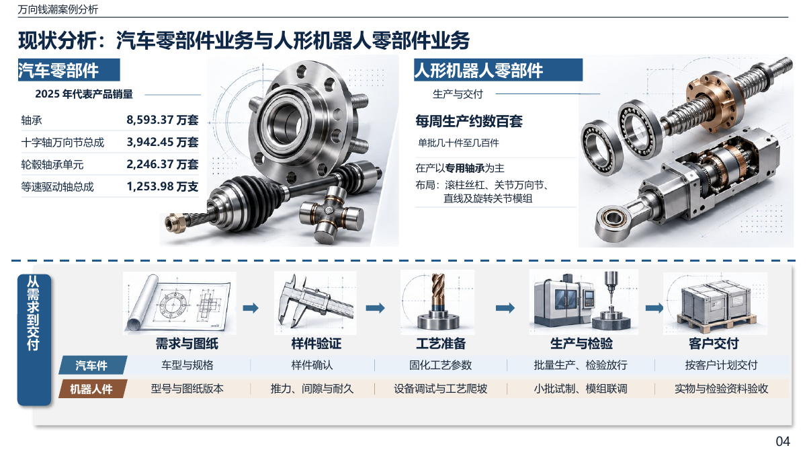
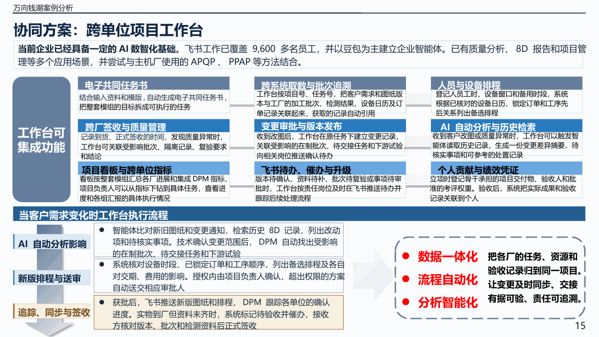

# 蓝色商务答辩 PPT

为中文案例答辩和商业分析制作信息密度高、结构清楚的 PPT。页面以蓝色商务风格为主，使用卡片、流程图、结构图和数据图表组织内容。

## 使用方式

在支持 Skills 的 Codex 环境中，将仓库内的两个技能目录放到技能目录下，例如：

```text
skills/
├── blue-business-ppt/
│   ├── SKILL.md
│   └── agents/openai.yaml
└── investment-chart-style/
    ├── SKILL.md
    ├── references/
    ├── scripts/
    └── examples/
```

然后调用 `$blue-business-ppt`，提供原始材料、页数、目标受众和具体排版要求。已有 PPT 修改任务以最新手改版本为基准。

- 首轮交付逐页 PNG，按反馈修改并再次审核。
- 审核确认后生成可编辑 PPTX，并检查其文字、形状、图表和数据。
- 涉及数据图表时，同步使用 `investment-chart-style`。图表技能的 Python 依赖见 [requirements.txt](investment-chart-style/requirements.txt)。

## 版式特点

- 深蓝标题、蓝灰色卡片及清晰的层次，充分利用内容区。
- 卡片使用可辨认的柔和投影，两个独立主体模块之间使用细虚线。
- 纵向流程可使用由浅至深的蓝色箭头，右侧以卡片说明各阶段内容。
- 默认微软雅黑和偶数整数号字。文字、形状及图表优先保留为可编辑对象。

具体规则见 [blue-business-ppt/SKILL.md](blue-business-ppt/SKILL.md)。用户对交付阶段、素材和风格的具体要求优先。

## 例图

以下为用户提供的案例答辩手改稿中的内容页，用于展示构图和版式。图中项目资料属于对应案例语境，制作其他主题时应使用任务自身的资料和数据。

| 页码 | 示例 | 页码 | 示例 |
|---|---|---|---|
| 03 | [经营与业务分析](examples/slide-03.png) | 04 | [业务对比](examples/slide-04.png) |
| 05 | [组织与业务流程](examples/slide-05.png) | 06 | [数字化与价值核算](examples/slide-06.png) |
| 07 | [运营机制](examples/slide-07.png) | 09 | [市场背景与政策](examples/slide-09.png) |
| 10 | [现象分析](examples/slide-10.png) | 11 | [指标与绩效问题](examples/slide-11.png) |
| 12 | [问题与理论](examples/slide-12.png) | 14 | [跨单位协同方案](examples/slide-14.png) |
| 15 | [项目工作台方案](examples/slide-15.png) | 16 | [项目指标方案](examples/slide-16.png) |




